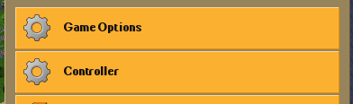
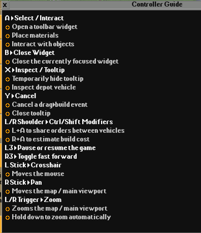
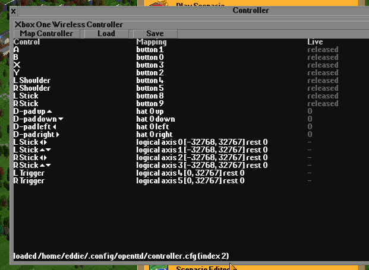
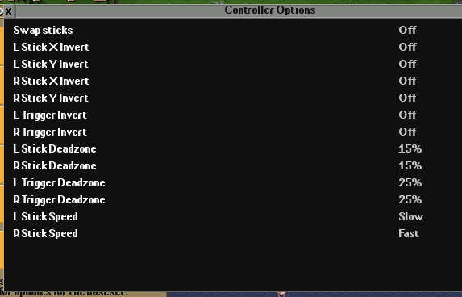
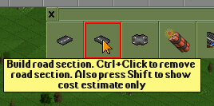

# OpenTTD Handheld

> **AI-use disclaimer.**
> This fork was created with substantial assistance from AI coding agents: research,
> design notes, code changes and documentation were produced or drafted with AI
> tooling and reviewed and tested afterwards by the maintainer. It is an
> **experimental, community-unverified fork** — expect rough edges, untested code
> paths and behaviour that differs from upstream. It is provided as-is, without any
> warranty, and is **not affiliated with, sponsored by, or endorsed by the OpenTTD
> team**.

OpenTTD Handheld makes a controller a first-class input method for OpenTTD on desktop
and Android. It is a self-contained fork for the maintainer's handhelds; general
OpenTTD documentation, downloads and support live in the
**[upstream OpenTTD README](https://github.com/OpenTTD/OpenTTD/blob/master/README.md)**.
Everything below describes only what this fork adds.

[](https://github.com/TechEdison0/OpenTTD-Handheld/actions/workflows/ci-desktop.yml?query=branch%3A1.x)
[](https://github.com/TechEdison0/OpenTTD-Handheld/actions/workflows/ci-android.yml?query=branch%3A1.x)


## Features

| Controller menu | Controller guide |
|---|---|
|  |  |

| Controller mapping | Controller options |
|---|---|
|  |  |

| Gamepad focus ring |
|---|
|  |

1. **Desktop (Windows / Linux)** — discover gamepads, normalize input, navigate the
   UI and play from a controller without breaking keyboard/mouse. The active input
   method switches automatically based on what you touch.
2. **Android** — a trackpad based touch interface, plus gamepad and keyboard/mouse.
   Touch gestures use relative movement rather than absolute screen coordinates.
3. **Controller-first navigation** — D-pad focus moves geometrically across live
   widgets and dropdown rows; A activates the focused widget and B backs out. The red
   focus ring shows the current target, and the left stick can take over as a crosshair.
4. **Controller setup in-game** — the Controller menu contains the button guide,
   the 18-step mapping flow and per-controller options. Invert, deadzone, stick speed
   and stick swap are stored per controller in `controller.cfg`; L3 pauses and R3
   toggles fast forward.
5. **No telemetry** — the startup participation survey is removed and survey
   transmission is compiled out. v1.0 binaries are built with `GAMEPAD_DEBUG_OFF`, so
   they ship no controller diagnostics window.

The implementation lives in `src/gamepad/` (discovery, normalization, bindings,
dispatch and persistence) and `src/controller_gui.*` (settings UI). UI behaviour
follows controller conventions from Cities: Skylines, Civilization and similar
top-down strategy games.

Base pin: upstream **`16.0-RC1`**
(`07b339c0aaeb0a87be9490b2f1c3f17c6b00b837`); rebased onto future upstream release
tags only, never nightlies.

## Dependencies

Only **Linux** needs anything beyond base system packages: music requires a
General-MIDI synthesizer plus a GM soundfont. Sound effects work without either.

| Debian/Ubuntu package | Purpose |
|---|---|
| `libfluidsynth3` | FluidSynth software synthesizer (runtime) |
| `timgm6mb-soundfont` (or `fluid-soundfont-gm`) | General-MIDI soundfont |

```bash
sudo apt install libfluidsynth3 timgm6mb-soundfont
```

Building from source additionally needs `libfluidsynth-dev`. Without FluidSynth the
build falls back to `extmidi` (an external player such as `timidity`) or silence.

- **Windows** — FluidSynth is compiled in via vcpkg and `soundfont.sf2` ships next to
  `openttd.exe`.
- **Android** — FluidSynth is compiled natively into the APK and the soundfont ships
  inside it.
- **Game content** — OpenGFX, OpenSFX, OpenMSX, NewGRFs, AIs and scripts are not
  included and must be downloaded separately.

## Download

The current stable release is **[v1.0](https://github.com/TechEdison0/OpenTTD-Handheld/releases/tag/v1.0)**.
Download the artifact for your platform from that release:

| Platform | File |
|---|---|
| Linux x86_64 | [`OpenTTD-Handheld-v1.0-linux-x86_64.zip`](https://github.com/TechEdison0/OpenTTD-Handheld/releases/download/v1.0/OpenTTD-Handheld-v1.0-linux-x86_64.zip) |
| Windows x86_64 | [`OpenTTD-Handheld-v1.0-win64.zip`](https://github.com/TechEdison0/OpenTTD-Handheld/releases/download/v1.0/OpenTTD-Handheld-v1.0-win64.zip) |
| Android arm64-v8a | [`OpenTTD-Handheld-v1.0-android-arm64-v8a-release.apk`](https://github.com/TechEdison0/OpenTTD-Handheld/releases/download/v1.0/OpenTTD-Handheld-v1.0-android-arm64-v8a-release.apk) |

Run Linux with `./openttd`. For Windows, double-click `wine_launch.sh` to run under
Wine, or launch `openttd.exe` directly. The Windows executable is **unsigned**:
SmartScreen or Smart App Control may warn. Download only from this GitHub release.
Install the Android APK directly; it is signed with this fork's release key.

There is no updater and no nightly channel. Older milestone pre-releases remain on the
releases page for provenance, but v1.0 is the supported current release.

## Development snapshots

Pre-release **T0 touch architecture** (`v20261128-t0-touch-architecture`) 

Highlights:
- New `src/touch/` subsystem beside `src/gamepad/` providing an Android-only absolute-tap touch backend; the donor overlay controls and in-game Android settings entry are removed.
- Build label mechanism (`OPENTTD_HANDHELD_BUILD_LABEL`) so the window caption and English main-menu footer display the pre-release tag (`OpenTTD Handheld v20261128-t0-touch-architecture`) on Linux, Windows and Android.
- Android library loading fixed: only `libmain.so` is loaded; no separate `libhidapi.so`.
- All three targets compile with `GAMEPAD_DEBUG_OFF`; controller diagnostics window absent.

## Tested configurations

Maintainer-tested combinations. This is a record of what has actually been checked, not a
guarantee that other hardware will work.

### Systems

| Release | Platform | Tested on |
|---|---|---|
| v1.0 | Linux | KDE Neon |
| v1.0 | Windows | Wine 9.0 |
| v1.0 | Android | Galaxy S25 Ultra |
| v1.0 | Android | Galaxy A11+ |
| `v20261127-c4-viewport-movement` | Android | Retroid Pocket Duo (top screen) |
| `v20261127-c4-viewport-movement` | Android | AYN Odin 2 Portal |

### Gamepads

| Gamepad | Connection | Tested with |
|---|---|---|
| 8BitDo Ultimate 2 | Bluetooth + USB 2.4 GHz dongle | v1.0 |
| 8BitDo SN30 Pro | Bluetooth | v1.0 |
| 8BitDo Ultimate MG | Bluetooth | v1.0 |
| Retroid Pocket Controller | USB wired | Retroid Pocket Duo, C4 |
| Odin Controller | USB wired | AYN Odin 2 Portal, C4 |

## Layout

| Path | Purpose |
|---|---|
| `src/` | engine, plus this fork's controller additions |
| `src/gamepad/` | controller subsystem: SDL discovery/hotplug, device registry, `controller.cfg` persistence |
| `src/controller_gui.*` | controller settings windows and their main-menu entry |
| `docs/screenshots/` | screenshots embedded above |
| `os/android/` | Gradle/NDK/vcpkg Android application project |
| `upstream-port/` | vendored additive build glue, Wine launcher, provenance and license notes |
| `THIRD_PARTY_NOTES.md` | third-party components and where they come from |
| `.github/workflows/ci-desktop.yml`, `ci-android.yml` | this fork's own build checks |

Upstream is tracked on the `upstream` remote; `main` is the integration branch and
`1.x` is the v1.x release branch and repository landing branch. Design research and
the decision log live in the workspace `research/` directory next to this clone.

## Compiling

Linux:

```bash
cmake -B build -DCMAKE_BUILD_TYPE=RelWithDebInfo
cmake --build build --parallel
```

Android (JDK 17+, SDK/NDK, CMake ≥ 3.31, Ninja, vcpkg):

```bash
cd os/android && ./gradlew assembleDebug
```

Windows produces a statically linked `openttd.exe` via MinGW cross-build. It needs
the **POSIX-threads** MinGW variant (Ubuntu's default win32-threads toolchain cannot
compile `<condition_variable>`) plus a native host-tools build, so it is scripted
rather than a one-liner:

```bash
sudo apt install -y gcc-mingw-w64-x86-64-posix g++-mingw-w64-x86-64-posix
```

Release builds must add `-DGAMEPAD_DEBUG_OFF` on Linux and Windows; Android injects
the same define through Gradle. The exact current recipes live in the maintainer's
build notes (`research/DECISIONS.md` and the project skill). See also `COMPILING.md`,
`os/android/README.md`, `THIRD_PARTY_NOTES.md`, `upstream-port/README.md` and
`upstream-port/LICENSES.md`.

## Credits and licensing

**OpenTTD** is Copyright © the OpenTTD developers and contributors and is licensed
under the **GNU General Public License, version 2.0** (GPL-2.0-only). The complete
license text ships as `COPYING.md`; upstream's copy and the full list of
engine-bundled third-party components are in the upstream README's "Licensing"
section. OpenTTD and its logo are the property of the OpenTTD project; this fork is
not affiliated with or endorsed by it. All modifications made by this fork are
released under the same GPL-2.0-only terms.

**Material added by this fork** is listed in
[`THIRD_PARTY_NOTES.md`](THIRD_PARTY_NOTES.md), with the per-component compliance
matrix in [`upstream-port/LICENSES.md`](upstream-port/LICENSES.md). In summary:

| Component | License | Where |
|---|---|---|
| OpenTTD engine | GPL-2.0-only | `COPYING.md` |
| psyycker/openttd-android build glue | GPL-2.0-only | vendored under `upstream-port/` |
| TimGM6mb General-MIDI soundfont | GPL-2 | `soundfont.sf2` in the APK and Windows package |
| SDL Java/bootstrap classes | zlib | `os/android/app/src/main/java/org/libsdl/` |
| Statically linked build dependencies | their own; see `LICENSES.md` | vcpkg / distro packages |
| Screenshots in `docs/screenshots/` | GPL-2.0-only, fork documentation | this repository |

**Source availability.** Corresponding source for everything shipped in this fork's
binaries is available from this repository — each package names its exact build
commit — and from the upstream projects of each GPL component under the terms of
their licenses.
